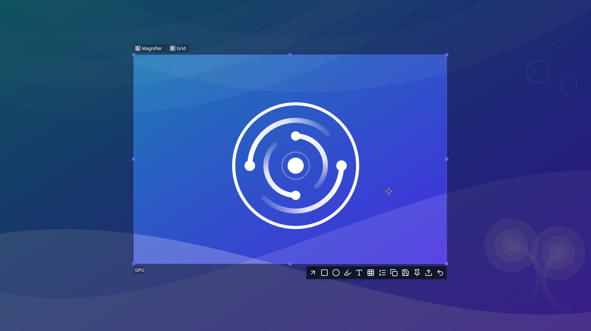

<div align="center">
  
  <h1>FlowShot</h1>
  <p><strong>Screenshot and annotation for Linux: free, open source, native on Wayland and X11.</strong></p>

  <p>
    <a href="https://github.com/FlowOSS/flowshot/releases"></a>
    <a href="https://aur.archlinux.org/packages/flowshot-bin"></a>
    <a href="https://aur.archlinux.org/packages/flowshot-git"></a>
    <a href="https://github.com/FlowOSS/flowshot/actions/workflows/ci.yml"></a>
    <a href="LICENSE"></a>
    <a href="#desktop-support"></a>
    <a href="#desktop-support"></a>
  </p>
</div>

<p align="center">
  
</p>

Capture any region of your screen, annotate it with modern tools, and export it instantly: copy to clipboard, save to disk, pin it to float on your desktop, or upload. 

Built natively for modern Linux desktops: no XWayland bridges, no per-compositor hacks, and full support for mixed-DPI multi-monitor setups.

## Why FlowShot

- **Pixel-perfect across mixed displays:** Geometry is physical-pixels-first, meaning fractional scaling and mixed-DPI monitors are captured accurately without blur or misaligned crops. Region selection spans all monitors as one unified canvas.
- **Native Wayland and X11 integration:** Probes your active session and selects the best native capture protocol (ext-image-copy-capture, wlr-screencopy, KWin ScreenShot2, XDG portal, or native X11 SHM).
- **GPU accelerated with CPU fallback:** Renders smoothly via Vulkan/wgpu with an automatic, zero-dependency software rasterizer fallback if GPU memory runs out or Vulkan is unavailable.
- **Privacy-first:** No data leaves your machine without your explicit confirmation. Crash reporting is opt-in, self-hosted, and transparent.
- **Secure redaction:** Pixelate and blur tools never leak interior pixel data, preventing reverse-engineering via block-mean recovery.

## Features

### Capture
- Interactive region selection spanning multiple monitors
- Full desktop and single-monitor capture
- Preselected regions, delayed capture timer, and instant accept-on-select
- Precision pixel magnifier with live RGB and HEX color readouts
- Standalone color picker tool (`flowshot color`)

### Annotation Suite
- **Drawing:** Pencil, straight lines, highlighters, and rectangles with adjustable corner radii
- **Smart arrows:** Straight or curved arrows with reversible heads
- **Text:** Crisp typography with native IME support for international languages
- **Step counters:** Auto-incrementing numbered bubbles that renumber automatically when deleted
- **Redaction:** Secure pixelation and gaussian blur
- **Controls:** Snapping grid, live geometry HUD, color palette editor, and full undo/redo

### Export & Sharing
- Copy directly to clipboard (PNG / JPEG)
- Save to disk with configurable patterns and image quality (PNG / JPEG / WebP)
- **Pin to desktop:** Float screenshots as always-on-top reference windows with zoom, rotate, and opacity controls
- Upload to Imgur with copyable links and deletion hashes
- Open directly in external image viewers or editors

## Installation

### Arch Linux (AUR)

FlowShot is available on the Arch User Repository:

```sh
# Pre-built binary package (recommended)
yay -S flowshot-bin

# Or build latest git trunk from source
yay -S flowshot-git
```

### Other Linux Distributions

Pre-compiled binary releases and AppImages are available on the [Releases page](https://github.com/FlowOSS/flowshot/releases).

<details>
<summary><strong>Building from source (for developers)</strong></summary>

Requires a Rust stable toolchain, `clang`, `pkg-config`, and PipeWire development headers (`pipewire` on Arch/Fedora, `libpipewire-0.3-dev` on Debian/Ubuntu):

```sh
git clone https://github.com/FlowOSS/flowshot.git
cd flowshot
cargo build --release

# Run the binary:
./target/release/flowshot capture
```
</details>

## Quick Start

The simplest way to use FlowShot is with your keyboard:

```sh
flowshot                     # Open the interactive screenshot overlay
flowshot settings            # Open the graphical settings window
flowshot color               # Quick eyedropper tool (copies HEX to clipboard)
```

### Hotkey Setup

To bind FlowShot to your **Print Screen** button:

* **Hyprland** (`hyprland.conf` / `hyprland.lua`):
  ```ini
  bind = ,Print,exec,flowshot capture
  ```
* **Sway / i3**:
  ```ini
  bindsym Print exec flowshot capture
  ```
* **GNOME / KDE:** Open system settings -> Keyboard Shortcuts -> Add custom shortcut -> Command: `flowshot capture`.

To view paste-ready shortcut snippets tailored for your current desktop, run:
```sh
flowshot --print-bind-help
```

## Desktop Support

| Desktop Environment | Capture Backend | Cursor Positioning | Status |
|---|---|---|---|
| **Hyprland** | ext-image-copy-capture | Native ICC cursor session + IPC | Fully supported (verified live) |
| **Sway / wlroots** | ext-image-copy-capture / screencopy | Native ICC cursor session | Fully supported |
| **KDE Plasma** | KWin ScreenShot2 D-Bus | Native cursor tracking | Fully supported |
| **COSMIC** | ext-image-copy-capture | Native ICC cursor session | Supported |
| **GNOME** | XDG Portal (ScreenCast / Screenshot) | Portal cursor support | Supported |
| **X11 (i3, bspwm, XFCE)** | Native X11 (MIT-SHM fast path) | Native XFixes cursor | Fully supported (verified live) |

FlowShot probes your live session automatically at runtime, picking the fastest available backend without requiring manual configuration.

## Configuration

Settings can be changed graphically in the settings window (`flowshot settings`) or in `~/.config/flowshot/flowshot.toml`.

```toml
config_version = 3

[save]
path = ""                    # default: system Pictures directory
filename_pattern = "%F_%H-%M"
actions = ["copy"]           # default actions: copy, save, pin, upload

[ui]
accent_color = "#6366F1"
cursor_style = "crosshair"   # "crosshair", "pointer", or "full-axis"

[daemon]
tray = true
```

For the complete list of options, ranges, and defaults, see the [Configuration Reference](docs/config-reference.md).

## Privacy & Crash Reporting

FlowShot is built with a privacy-first approach:
- **No data leaves your computer without consent:** You are prompted on first launch to choose whether to send crash diagnostics. If you decline or dismiss the prompt, error reporting is completely inactive, even anonymously.
- **No image data is ever sent:** Screenshots, image buffers, and file paths are never transmitted.
- **Self-hosted and minimal:** Crash reports are sent to our self-hosted Sentry instance, not third-party advertising or analytics networks.
- You can review or toggle reporting preferences at any time in `flowshot settings` under the General tab.

## Project Status

FlowShot is under active development towards v1.0:
- Native Wayland (ICC, screencopy, KWin) and native X11 backends are implemented and tested.
- GPU-accelerated rendering with automatic CPU fallback is active.
- AUR packages (`flowshot-bin` and `flowshot-git`) are maintained.
- Codebase maintains comprehensive test suites, platform purity checks, and strict formatting.

Contributions, bug reports, and feedback are welcome!

## Development

```sh
just check                    # Full quality gate: fmt + clippy + tests + deny
cargo test --workspace        # Run the complete test suite
cargo build --workspace       # Build all crates
```

Contributor guidelines: [CONTRIBUTING.md](CONTRIBUTING.md).  
Architecture Decision Records: [docs/architecture/](docs/architecture/).

## License

GPL-3.0-or-later. See [LICENSE](LICENSE) for details. Third-party notices: [NOTICES](NOTICES).
